# schema-timeline

[English](README.md) · **한국어**

**DB 스키마 변경사항을 시각화하는** [Claude Code](https://claude.com/claude-code) Skill 입니다. 마이그레이션 이력(Flyway, Supabase, Prisma, Drizzle, 번호 붙은 SQL 파일)을 임시 컨테이너에 실제로 재생해서 **HTML 한 장**으로 보여 줍니다. 이 한 장에 들어가는 것:

> **[인터랙티브 데모 체험하기](https://myeoungdev.github.io/schema-timeline/ko/)** · [English demo](https://myeoungdev.github.io/schema-timeline/en/)

- 버전 타임라인
- 단계별 스키마 diff 와 변경 리뷰, 관계도(ERD)
- 이름 변경까지 이어 주는 테이블·컬럼 계보(스키마 변경 이력)
- 시점별 전체 DDL

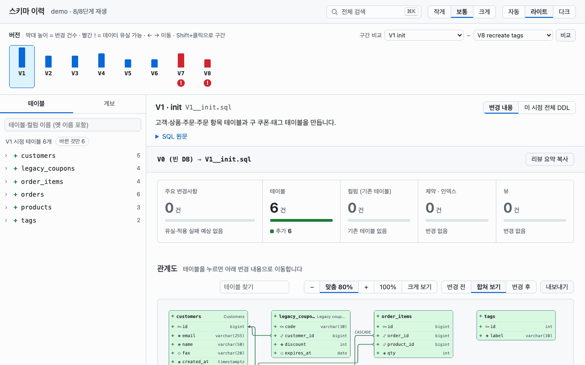

버전마다 보이는 스키마는 마이그레이션을 실제 DB 에 적용한 뒤 카탈로그에서 읽은 것입니다. SQL 을 읽고 짜 맞춘 스키마가 아닙니다.

> [!NOTE]
> 화면은 한국어와 영어로 나옵니다(`--lang ko|en`). 위 움직이는 화면과 아래 화면은 이 저장소의 [`samples/demo`](samples/demo)(PostgreSQL, 10단계·테이블 17개)를 재생한 결과입니다. DDL 두 개 비교 화면은 [`samples/v1.sql`](samples/v1.sql)과 [`samples/v2.sql`](samples/v2.sql)을 비교한 것입니다.

## 기능

배포 전 마이그레이션 검토, "이 컬럼 언제 생겼어?" 같은 질문, 스키마 덤프 두 개 비교에 씁니다.

- **추측이 아닌 재생.** 마이그레이션을 순서대로 임시 PostgreSQL·MySQL·MariaDB·Oracle 컨테이너에 적용하고, 단계마다 카탈로그를 스냅샷으로 뜹니다.
- **단계별 변경 리뷰.**
  - 건수 요약 띠
  - 데이터가 사라지거나 기존 행 때문에 실패할 수 있는 변경만 모은 "주요 변경사항"
  - 배포 전 확인 쿼리: 운영 DB에서 배포 전에 돌려 볼 읽기 전용 `SELECT`(`NOT NULL` 전 NULL 개수, `UNIQUE` 전 중복, 길이 축소 전 넘치는 값, FK 전 고아 행, 사라질 데이터 양). 화면은 쿼리를 만들기만 하고 DB 에 접속하지 않습니다.
  - 엔진별 잠금 힌트: 운영 중 실행하면 테이블을 잠그거나 다시 쓰는 변경. 예: PostgreSQL 의 `CONCURRENTLY` 없는 `CREATE INDEX`·`NOT VALID` 없는 FK, MySQL 의 테이블 복사, Oracle 의 `ONLINE` 없는 인덱스.
  - 확대·축소·끌어서 이동·두 손가락 확대·테이블 찾기(나머지는 흐리게)가 되는 관계도
  - 테이블별 구조 diff
- **이름 변경 확정.** 이름 변경과 삭제 후 추가를 객체 식별자로 구분해 "확정"과 "의심"으로 나눕니다. 식별자는 PostgreSQL 은 `oid`·`attnum`, 다른 엔진은 `RENAME`·`CHANGE` 문입니다.
- **테이블째 삭제를 한눈에.** 지우거나 다시 만든 테이블은 테이블 단위로 라벨과 취소선을 붙여, 컬럼 삭제와 헷갈리지 않습니다.
- **계보.** 테이블·컬럼이 언제 생기고 이름·타입이 바뀌고 지워졌는지, 옛 이름까지 보여 줍니다.
- **구간 비교.** 두 버전을 골라 그 사이 변경을 한 번에 봅니다.
- **전체 검색(⌘K / Ctrl+K).** 테이블, 컬럼, 버전, 모든 단계의 SQL 원문, 명령을 한곳에서 찾습니다.
- **전체 SQL 보기.**
  - 테이블마다 구조 diff 와 바뀐 줄을 표시한 `CREATE` 문 전체를 오갑니다.
  - 어느 버전이든 스키마 전체 DDL 을 보거나 저장합니다.
- **DDL 두 개 비교.** 스키마 덤프 두 개를 같은 화면으로 비교합니다.
- **내보내기.** Mermaid ERD(`.mmd`), SVG, PNG, PR 에 붙일 Markdown 리뷰 요약.
- **파일 한 장, 외부 요청 0건.** 메일이나 위키에 그대로 첨부할 수 있습니다. 라이트·다크 테마와 한국어·영어 화면을 지원합니다.

## 화면

| | |
|---|---|
| 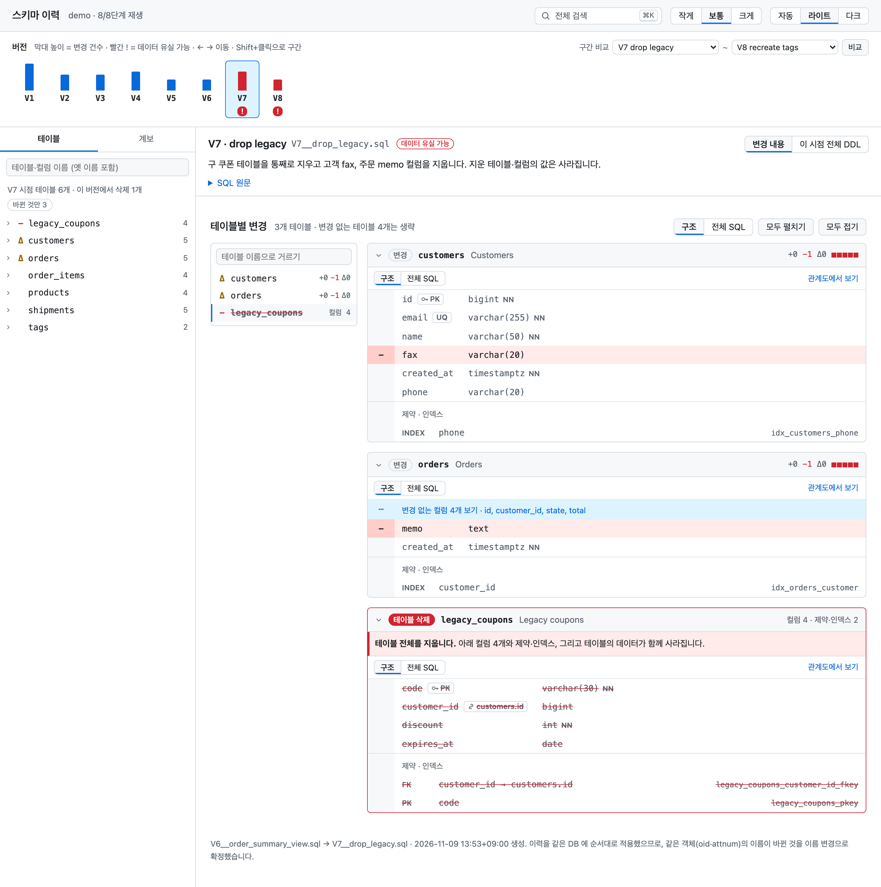<br>**테이블째 삭제와 컬럼 삭제.** 지운 테이블은 채운 라벨, 안내 띠, 취소선 줄로 보입니다. 남는 테이블의 컬럼 삭제는 빨간 `−` 줄입니다. | 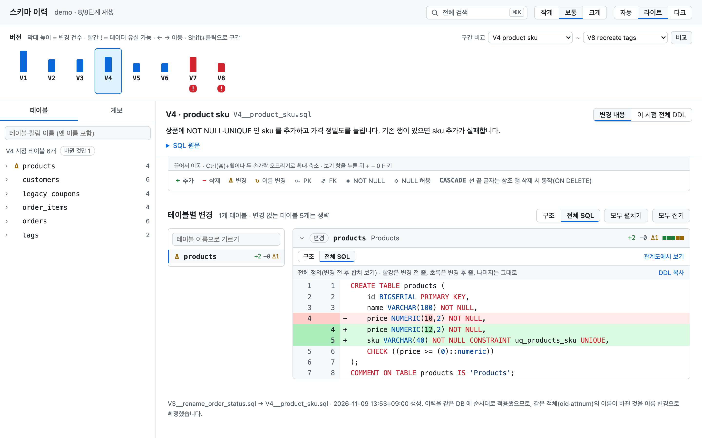<br>**전체 SQL 보기.** `CREATE TABLE` 전체를 보여 주고, 지운 줄은 빨강, 추가한 줄은 초록으로 칠합니다. |
| 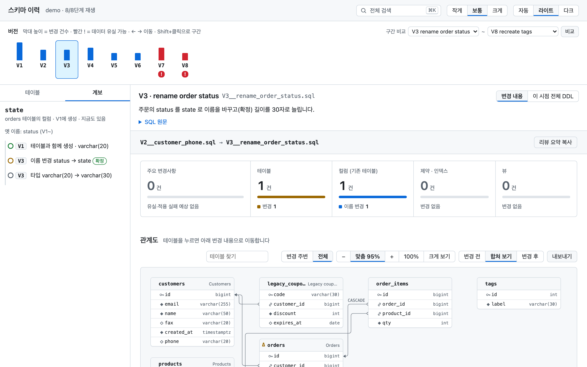<br>**계보.** `orders.state` 는 V1 에 `status` 로 생겨 V3 에서 이름이 바뀌었습니다. 이름 변경은 확정입니다. | 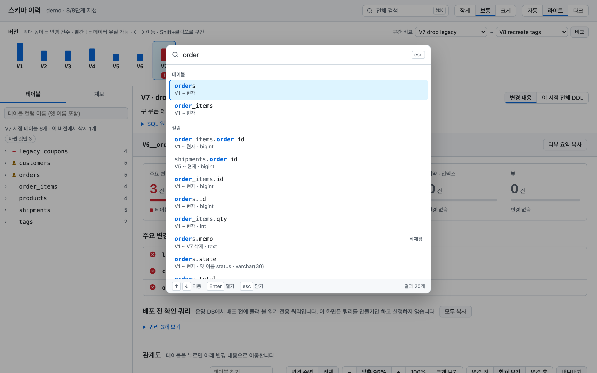<br>**전체 검색.** 테이블, 컬럼(옛 이름 포함), 버전, SQL 원문, 명령을 한 칸에서 찾습니다. |
| 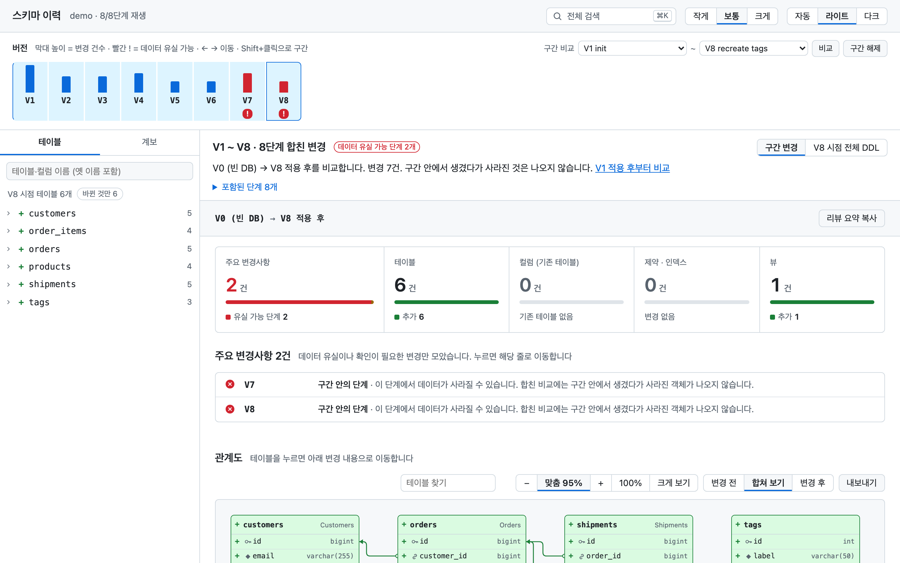<br>**구간 비교.** Shift+클릭하거나 두 버전을 골라 합친 변경을 봅니다. | 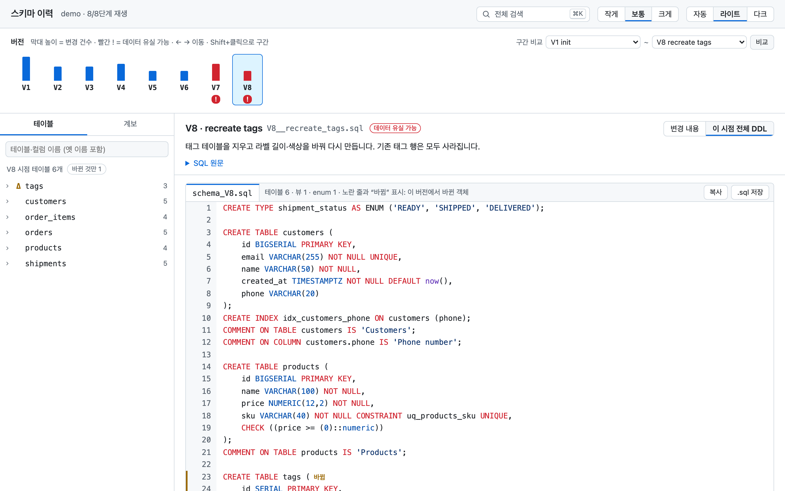<br>**시점별 스키마.** V8 시점의 전체 DDL 입니다. 그 버전에서 바뀐 객체에 표시가 붙습니다. |
| 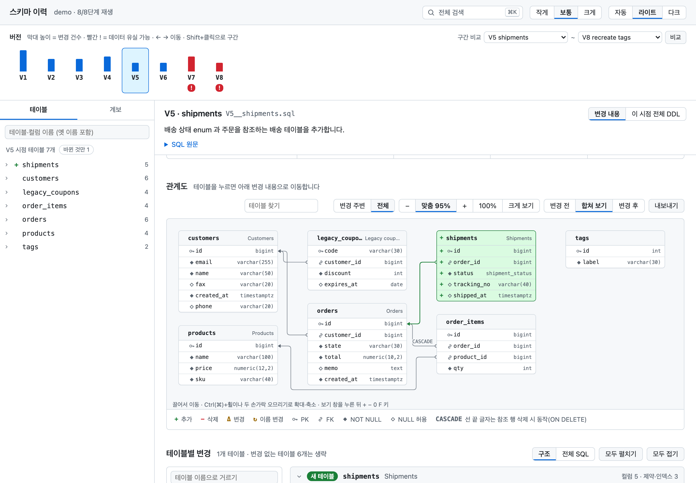<br>**관계도.** V5 에서 `orders` 를 참조하는 `shipments` 가 추가됐습니다(초록). 변경 전·합쳐 보기·변경 후를 오가고, 확대·이동·찾기·내보내기가 됩니다. | 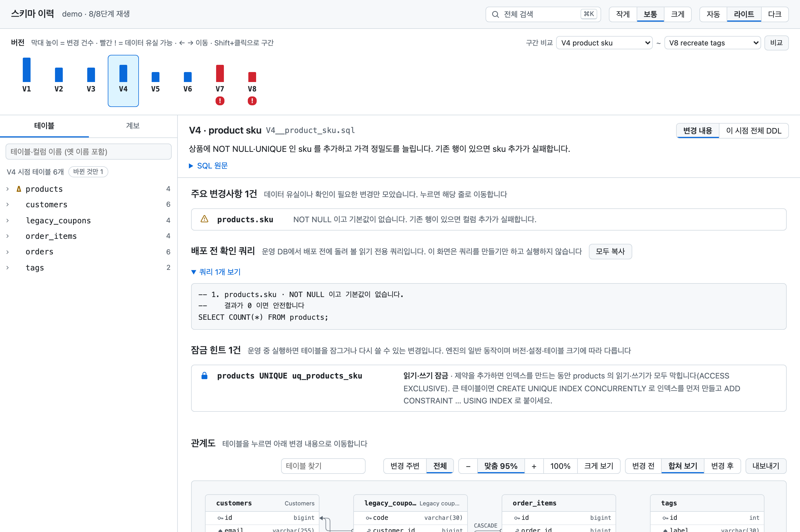<br>**배포 전 확인 쿼리와 잠금 힌트.** V4 는 기본값 없는 `NOT NULL` 컬럼을 추가합니다. 먼저 돌려 볼 `SELECT` 를 만들어 주고, `UNIQUE` 제약이 테이블을 잠근다고 알려 줍니다. |
| 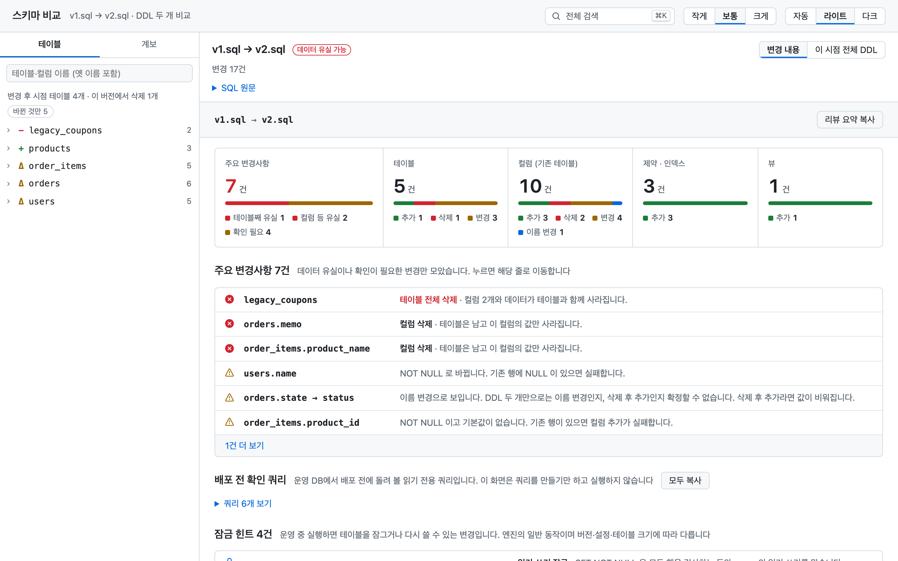<br>**DDL 두 개 비교.** `compare.sh v1.sql v2.sql` 로 스키마 덤프 두 개를 같은 리뷰 화면으로 봅니다. 이름 변경은 "의심"으로만 표시됩니다. | 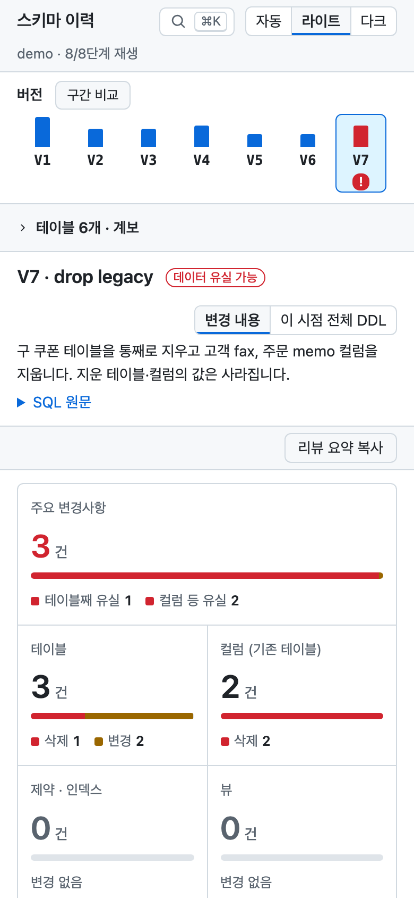<br>**휴대폰에서.** 테이블 목록과 구간 비교를 접어 두어 첫 화면에서 바로 리뷰가 보입니다. |

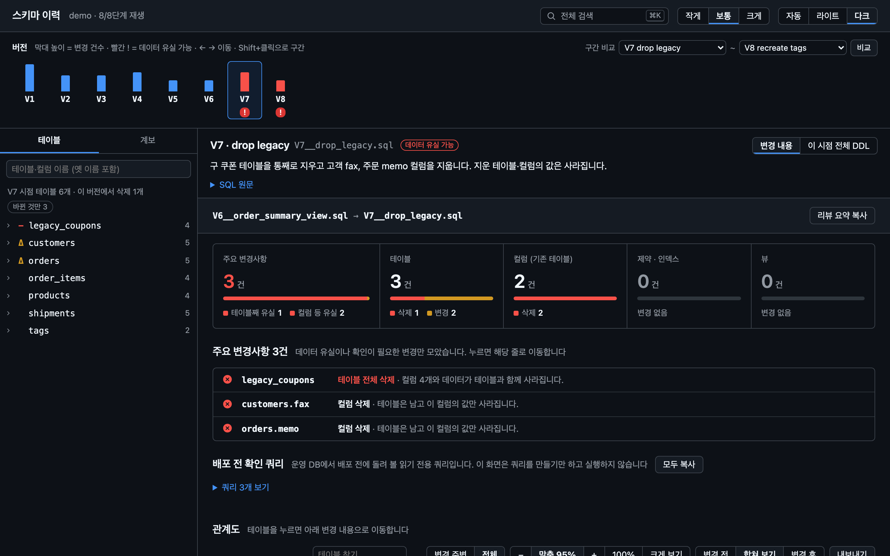

## 필요한 것

- Docker
- Python 3.9 이상 (표준 라이브러리만 씀)
- 선택: Node.js 22 이상과 Google Chrome 또는 Chromium. 만든 페이지를 헤드리스 브라우저로 자체 점검(`check_html.mjs`)하고 화면을 캡처(`docs/capture.mjs`)할 때 씁니다.
- 선택: Node.js 만. ERD 내보내기(`export_erd.mjs`)와 CI 용 검토 리포트(`report.mjs`)에 씁니다.
- Windows: WSL 2 에서 씁니다. 진입 스크립트가 bash 입니다.

기본 이미지는 필요할 때만 받습니다.

| `--db` | 이미지 |
|---|---|
| `postgres` (기본) | `postgres:16-alpine` |
| `mysql` | `mysql:8.4` |
| `mariadb` | `mariadb:11.4` |
| `oracle` | `gvenzl/oracle-free:23-slim` (기동에 수십 초) |

## 설치

플러그인으로 설치(Claude Code 2.1.275 이상, Claude Code 안에서):

```
/plugin install schema-timeline --marketplace <owner>/<repo>
```

또는 Skill 디렉터리에 직접 받습니다.

```bash
git clone <your-repo-url> ~/.claude/skills/schema-timeline
```

둘 다 같은 Skill 입니다. 한 프로젝트에서만 쓰려면 `<프로젝트>/.claude/skills/schema-timeline` 에 받습니다.

## 사용법

### Claude Code 에서

마이그레이션이 있는 레포에서 평소 말로 요청합니다. 예:

- "이 레포 마이그레이션 이력 보여줘"
- "`orders.state` 는 언제 생겼고 전에는 이름이 뭐였어?"
- "V5 부터 V20 사이에 뭐가 바뀌었어?"
- "`schema_before.sql` 이랑 `schema_after.sql` 비교해줘"

Claude 는 다음 순서로 진행합니다.
1. 마이그레이션 형식과 DB 를 감지합니다.
2. 감지하지 못한 것만 묻습니다(어느 스키마인지, 이미지를 받아도 되는지 등).
3. 이력을 재생하고 단계마다 한 줄 요약을 씁니다. 요약과 화면은 사용자가 쓰는 언어로 나옵니다.
4. 만든 `timeline.html` 을 엽니다.

### 명령줄에서

```bash
# 마이그레이션 이력 → <출력>/timeline.html
bash scripts/timeline.sh <레포 또는 마이그레이션 디렉터리> <출력> [--db postgres|mysql|mariadb|oracle] \
     [--format flyway|sqlfiles|supabase|prisma|drizzle|git-snapshots] [--file <경로>] \
     [--schema <이름>] [--image <이미지>] [--ignore-repeatable] [--lang ko|en] \
     [--placeholder <이름>=<값>] [--replace '<원문>=<값>'] \
     [--no-sql] [--step-timeout <초>]

# DDL 두 개 → <출력>/timeline.html ("스키마 비교" 제목의 1단계 타임라인. <출력> 기본값은 ./out)
bash scripts/compare.sh before.sql after.sql [<출력>] [--db ...] [--image ...] [--schema ...] [--lang ko|en]

# CI·PR 코멘트용 검토 리포트(단계별 위험. --fail-on 이상 위험이 있으면 종료 코드 4)
node scripts/report.mjs <출력> [--step N | --from A --to B | --all] [--format json|md] \
     [--fail-on danger|attention|none] [--lang ko|en]

# N 단계 적용 후의 Mermaid ERD
node scripts/export_erd.mjs <출력> --step N --out erd.mmd

# 중단된 실행이 남긴 컨테이너·네트워크 지우기
python3 scripts/replay.py --cleanup
```

- `--no-sql` 은 페이지에서 SQL 원문을 뺍니다(카탈로그에서 다시 만든 DDL 은 남습니다). 공유하고 싶지 않은 시드 데이터가 마이그레이션에 있을 때 씁니다. 출력 디렉터리 자체에는 SQL 이 남습니다.
- `--step-timeout` 은 주어진 초보다 오래 걸리는 단계를 멈추고 실패로 표시합니다(기본 300, `0` 이면 제한 없음).
- 컨테이너는 자원 제한을 걸고 돕니다: 메모리 1GB(Oracle 3GB), CPU 2개, 프로세스 수 상한. `SCHEMA_TIMELINE_MEMORY`, `SCHEMA_TIMELINE_CPUS`, `SCHEMA_TIMELINE_PIDS` 로 바꿉니다.

`--lang` 은 화면과 터미널 출력의 언어입니다. 주지 않으면 `SCHEMA_TIMELINE_LANG`, 그다음 시스템 로케일(한국어 로케일이면 `ko`), 그다음 영어 순으로 정합니다. 단계 요약은 선택 사항입니다. `<출력>/summary.json` 에 `{"<파일 이름>": "요약"}` 을 넣고 `render_timeline.py` 를 다시 돌리면 붙습니다.

`python3 scripts/detect.py <레포>` 는 감지 결과를 보여 줍니다. 형식, 마이그레이션 디렉터리, DB 종류, 스키마 후보, 경고가 나옵니다.

### CI 에서

PR 마다 재생하고 리포트를 올립니다. 최소 GitHub Actions 예:

```yaml
- uses: actions/checkout@v4
- run: git clone --depth 1 <your-repo-url> /tmp/schema-timeline
- run: docker pull postgres:16-alpine
- run: bash /tmp/schema-timeline/scripts/timeline.sh db/migration out --lang ko --no-sql
- run: node /tmp/schema-timeline/scripts/report.mjs out --format md > review.md
```

`report.mjs` 종료 코드:

| 코드 | 뜻 |
|---|---|
| 0 | `--fail-on`(기본 `danger`) 이상 위험 없음 |
| 4 | `--fail-on` 이상 위험 있음 |
| 1 | 재생 중 실패한 단계가 있음(4 보다 우선) |
| 2 | 사용법·파일 오류 |

리포트는 화면의 "주요 변경사항"과 같은 규칙을 씁니다. 위험마다 배포 전 확인 쿼리(`check`)가 붙고, 단계마다 그 쿼리를 묶은 `checks` 스크립트와 잠금 힌트(`hints`)가 들어갑니다. 잠금 힌트는 `--fail-on` 에 들어가지 않습니다. Claude 도 브라우저도 필요 없고, Claude 가 쓰는 단계 요약은 들어가지 않습니다.

### 데모 돌려 보기

```bash
bash scripts/timeline.sh samples/demo /tmp/schema-demo
open /tmp/schema-demo/timeline.html        # Linux 는 xdg-open
```

주소 끝에 `#step=5`, `#step=5&view=ddl`, `#from=5&to=20`(구간)을 붙이면 그 화면이 바로 열립니다.

## 지원하는 입력

| 이력 모양 | `--format` |
|---|---|
| Flyway `V<버전>__<설명>.sql` | `flyway` |
| 번호·타임스탬프가 붙은 SQL 파일. 파일 단위로 적용하는 Liquibase *formatted SQL* 포함. `.up.sql`/`.down.sql` 짝(golang-migrate)은 `.up.sql` 만 재생 | `sqlfiles` |
| Supabase CLI `supabase/migrations/<ts>_<이름>.sql` | `supabase` |
| Prisma Migrate `prisma/migrations/<ts>_<이름>/migration.sql` | `prisma` |
| Drizzle Kit `NNNN_<이름>.sql` + `meta/_journal.json` | `drizzle` |
| git 에서 계속 고쳐 온 스키마 파일 하나(`schema.sql`, `init.sql`) | `git-snapshots --file <경로>` |

`--format` 이 없으면 이렇게 고릅니다. `--file` 이 있으면 `git-snapshots`, 아니면 그 아래에서 찾은 Flyway·Prisma·Drizzle·Supabase 중 한 형식, 그것도 없으면 번호 붙은 SQL 파일이 모인 디렉터리 한 곳(`node_modules`, `build`, seed·test 디렉터리는 보지 않음), 아무것도 없으면 `flyway` 입니다. 형식이 섞여 있거나 해당 디렉터리가 여러 곳이면 멈추고 `--format` 과 경로를 달라고 합니다. Prisma·Drizzle·Supabase 이력은 레포 루트 아래 깊은 곳(모노레포의 `packages/db/prisma/migrations` 등)에 있어도 찾습니다.

Flyway baseline(`B<버전>__*.sql`)은 가장 높은 것을 먼저 적용하고, 그 버전 이하의 V 파일은 건너뜁니다. `--placeholder 이름=값` 은 형식과 관계없이 단계 SQL 의 `${이름}` 을 바꿉니다. `--format flyway` 면 `${flyway:defaultSchema}`·`table`·`filename`·`timestamp` 는 자동으로 채웁니다. `--replace '원문=값'` 은 Go 의 `{{ index .Options "Namespace" }}` 같은 다른 템플릿 문구를 바꿉니다. 마지막 `=` 에서 나누고 공백 차이는 무시합니다. 아무것도 바꾸지 못한 옵션은 경고로 알립니다. 치환한 값은 페이지의 SQL 에 그대로 보이고, 이름이 비밀처럼 끝나는(`dbPassword`, `jwt_secret`, `apiKey`, `private_key`, `token`) placeholder 는 값이 네 글자 이상이면 그 자리를 `********` 로 보입니다. 이미지에 없는 확장(pgvector, PostGIS, TimescaleDB)이나 치환되지 않은 자리표시자 때문에 단계가 실패하면 오류 끝에 쓸 옵션을 알려 줍니다.

엔진은 PostgreSQL, MySQL, MariaDB, Oracle 입니다. Prisma·Drizzle 은 provider·dialect 가 이 중 하나일 때 재생합니다. 기본값이 `postgres` 이므로 맞는 `--db`(예: `--db mysql`)를 함께 줍니다. Supabase 는 PostgreSQL 로 재생하고, 플랫폼 스키마(`auth`, `storage`, 역할)는 최소한으로 흉내 냅니다.

## 동작 방식

```
sources.py   →  replay.py           →  timeline.py            →  render_timeline.py
(어댑터:        (임시 컨테이너에        (단계 diff, 이벤트,        (HTML 한 장,
 Flyway 등)      단계마다 적용하고       계보, 이름 변경 확정)      templates/)
                 카탈로그 스냅샷)
```

엔진마다 다른 기동·적용·카탈로그 조회는 `engines.py`·`engine_*.py` 에 있습니다. 끝으로 `timeline.sh`·`compare.sh` 가 `check_html.mjs` 로 페이지를 헤드리스 Chrome 에서 열어 점검하고, JSON 영수증을 `<출력>/check.json` 에 남깁니다. 점검 항목은 다음과 같습니다.

- 스크립트 오류, 외부 요청
- 1280px·375px 가로 넘침
- 모든 단계의 리뷰
- ERD 내보내기, 검색

## 안전

- **사용자 DB 에 접속하지 않습니다.**
  - 재생은 네트워크를 끊은 임시 컨테이너에서 하고, 끝나면 지웁니다.
  - Oracle 은 사설 IP 가 있어야 뜨므로, 외부 경로가 없는 docker `--internal` 네트워크를 재생마다 만들고 지웁니다.
- **접속 설정은 DB 종류를 알아내는 데만 씁니다.** `detect.py` 는 `flyway.conf`, `application.yml` 같은 파일의 JDBC URL 에서 DB 종류와 스키마 이름만 뽑습니다. URL·계정·비밀번호로 접속하거나, 기록하거나, 다른 곳에 넘기지 않습니다.
- **레포는 읽기만 합니다.** Claude 가 돌릴 때 결과는 따로 정하지 않으면 `~/.cache/schema-timeline/<레포>/` 에 둡니다.
- **비밀번호를 가립니다.** SQL(`IDENTIFIED BY`, `PASSWORD` 등)과 카탈로그 텍스트의 비밀번호는 페이지에 들어가기 전에 가립니다. SQL 의 다른 데이터(시드 행, 주석)는 가리지 않으니 `--no-sql` 로 SQL 을 뺍니다.
- **실행을 묶어 둡니다.** 컨테이너마다 메모리·CPU·프로세스 제한이 있고, 단계마다 시간 제한이 있습니다. 모든 컨테이너·네트워크에 `schema-timeline` 라벨이 붙어 `replay.py --cleanup` 으로 남은 것을 지울 수 있습니다.
- **믿을 수 없는 마이그레이션.** 마이그레이션은 컨테이너 안에서 어떤 SQL 이든 실행할 수 있습니다. 출처를 믿을 수 없는 이력(포크에서 온 PR 등)은 격리된 CI 러너에서 돌리세요. [SECURITY.md](SECURITY.md) 참고.

## 한계

- SQL Server 는 아직 지원하지 않습니다.
- 재생하지 않는 것:
  - Liquibase XML·YAML changelog
  - 코드로 된 마이그레이션(Java, Alembic, Rails, Django)
  - Flyway 반복 마이그레이션·콜백
- 스냅샷 범위:
  - 담는 것: 스키마 하나의 테이블·컬럼·제약·인덱스·뷰·코멘트, PostgreSQL enum 타입
  - 스키마 diff 밖: 함수·프로시저·트리거·패키지·시퀀스. 단계마다 이름으로 추가·삭제·변경(Oracle 은 컴파일 오류 포함)을 따로 보여 줍니다.
  - 담지 않는 것: domain·RLS 정책
- 재생하지 않는 파일은 경고로 알립니다: Flyway undo(`U…`), 소문자 `v…`, `.SQL` 확장자. 버전 공백도 안내합니다.
- 이름 변경은 이력을 DB 하나에 재생할 때만 확정됩니다. DDL 두 개 비교와 `git-snapshots` 는 "의심"으로만 표시합니다.
- MySQL·MariaDB·Oracle 의 DDL 은 트랜잭션으로 묶이지 않습니다. 실패한 단계는 일부만 적용된 채 남고, 그 단계의 스냅샷은 없습니다.
- 버전마다 보이는 DDL 은 카탈로그에서 다시 만든 것입니다. 원본 파일과 글자 단위로 같지 않습니다.
- 규모: 300단계, 마지막 시점 테이블 152개인 합성 PostgreSQL 이력이 Apple M3 Pro 에서 재생·렌더·자체 점검까지 약 2분 걸렸고 페이지는 6.5MB 였습니다. 매번 빈 DB 부터 다시 재생하며 증분 캐시는 없습니다.

## 개발

준비 방법, 규칙, 풀 리퀘스트 확인 목록은 [CONTRIBUTING.ko.md](CONTRIBUTING.ko.md), 변경 이력은 [CHANGELOG.md](CHANGELOG.md)에 있습니다.

```bash
python3 -m unittest discover -s tests          # 테스트 258개. 재생 테스트는 Docker 와 엔진 이미지가 있어야 돎(CI 는 MySQL·MariaDB·Oracle 을 건너뜀)
node scripts/check_html.mjs <출력>/timeline.html # 헤드리스 자체 점검, JSON 영수증 출력
bash docs/build_demo.sh                         # samples/demo 를 두 언어로 재생해 README 화면과 GIF 다시 만들기(GIF 는 Pillow 필요)
```

```
SKILL.md         Skill 이 동작할 때 Claude 가 따르는 지침
.claude-plugin/  플러그인·마켓플레이스 매니페스트
scripts/         감지, 재생, diff, 계보, 렌더, 점검
templates/       타임라인 화면, 변경 리뷰 화면, 공용 CSS·JS
references/      재생 전에 Claude 가 읽는 엔진·도구별 참고
samples/         예제 이력 (demo, flyway, mysql, oracle, oracle_retail, supabase, prisma, drizzle)
tests/           단위·재생 테스트
docs/            README 화면과 GIF(en/, ko/), 데모 단계 요약, 이를 다시 만드는 스크립트
```

## 상표와 외부 이미지

Flyway, Oracle, PostgreSQL, MySQL, MariaDB, Supabase, Prisma, Drizzle 은 각 소유자의 상표입니다. 이 프로젝트는 그들과 제휴하거나 보증받지 않았습니다.

DB 이미지는 실행할 때 Docker Hub 에서 받으며 이 저장소에 들어 있지 않습니다. 이미지마다 자체 라이선스를 따르고, `gvenzl/oracle-free` 에 든 Oracle Database Free 는 Oracle 의 Free Use Terms and Conditions 를 따릅니다.

## 라이선스

[MIT](LICENSE)
