# schema-timeline

**English** · [한국어](README.ko.md)

**Visualize database schema changes over time.** A [Claude Code](https://claude.com/claude-code) skill that replays your database migration history (Flyway, Supabase, Prisma, Drizzle, plain SQL files) in a throwaway container and turns it into **one self-contained HTML page**. The page holds:

> **[Try the interactive demo](https://myeoungdev.github.io/schema-timeline/)** · [한국어 데모](https://myeoungdev.github.io/schema-timeline/ko/)

- A version timeline.
- A schema diff and change review for every step, with an ER diagram (ERD).
- Table and column lineage that follows renames: the schema evolution of each object.
- The full schema DDL at any point in time.

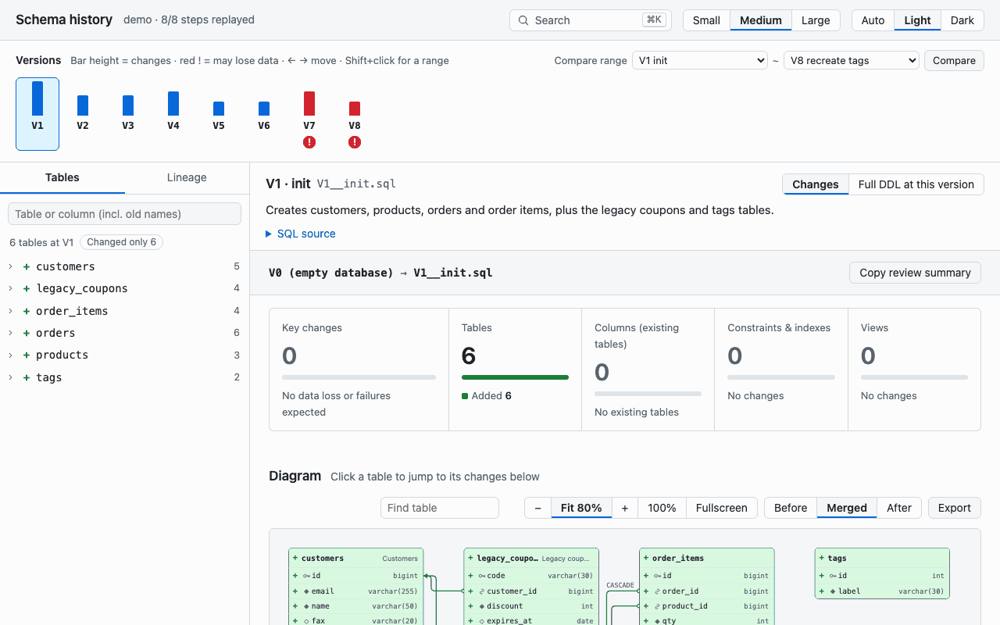

The schema shown for each version is read from the database catalog after the migrations were actually applied. It is never reconstructed by parsing SQL.

> [!NOTE]
> The page is available in English and Korean (`--lang en|ko`). The animation above and the screenshots below come from [`samples/demo`](samples/demo), a 10-step PostgreSQL history with 17 tables; the two-DDL screenshot compares [`samples/v1.sql`](samples/v1.sql) and [`samples/v2.sql`](samples/v2.sql).

## Features

Use it to review a migration before it ships, to answer "when was this column added?", or to compare two schema dumps.

- **Real replay, not guesswork.** Each migration is applied in order to a temporary PostgreSQL, MySQL, MariaDB or Oracle container, and the catalog is snapshotted after every step.
- **Change review for every step.**
  - Summary strip of counts.
  - "Key changes" list of what loses data or may fail on existing rows.
  - Pre-deploy check queries: read-only `SELECT`s to run on production before shipping (NULLs before `NOT NULL`, duplicates before `UNIQUE`, values too long before a shrink, orphan rows before an FK, rows that will lose data). The page only writes them; it never connects to a database.
  - Locking hints per engine: changes that can lock or rewrite a table on a live database, such as PostgreSQL `CREATE INDEX` without `CONCURRENTLY` or an FK without `NOT VALID`, a MySQL table copy, or an Oracle index without `ONLINE`.
  - Interactive ER diagram you can zoom, pan, pinch and search, with the rest dimmed.
  - Per-table structural diff.
- **Confirmed renames.** A rename is told apart from a drop-and-add by object identity (PostgreSQL `oid`/`attnum`, or the `RENAME`/`CHANGE` statement on other engines). It is marked *confirmed* or *suspected*.
- **Whole-table drops stand out.** A dropped or recreated table is labelled and struck through as a whole, so it is never confused with a dropped column.
- **Lineage.** See when any table or column was created, renamed, retyped or dropped, including its old names.
- **Range compare.** Pick any two versions to see their combined change.
- **Global search (⌘K / Ctrl+K).** Search tables, columns, versions, the SQL source of every step, and commands.
- **Full SQL view.** Switch each table between the structural diff and its complete `CREATE` statement with changed lines highlighted. View or download the whole schema DDL at any version.
- **Two-DDL compare.** Diff two schema dumps on the same screen.
- **Export.** Mermaid ERD (`.mmd`), SVG, PNG, and a Markdown review summary for pull requests.
- **One file, zero network.** The page makes no external requests, so it can be emailed or attached to a wiki as is. Light and dark themes, English and Korean UI.

## Screenshots

| | |
|---|---|
| 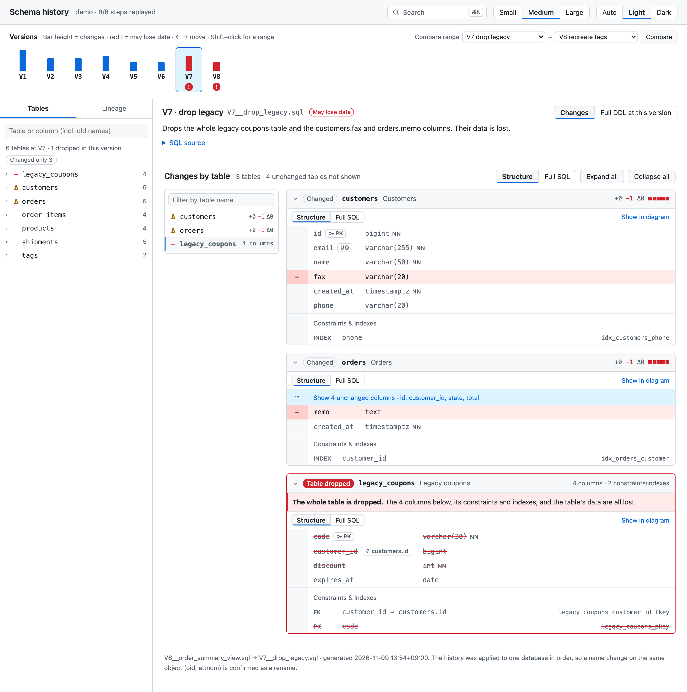<br>**Whole-table drop vs. column drop.** A dropped table gets a filled label, a banner and struck-through rows. A dropped column in a surviving table stays a red `−` row. | 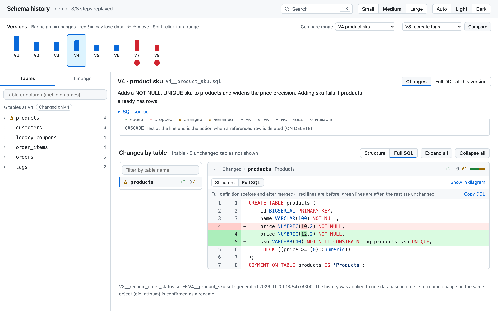<br>**Full SQL view.** The complete `CREATE TABLE` with removed lines in red and added lines in green. |
| 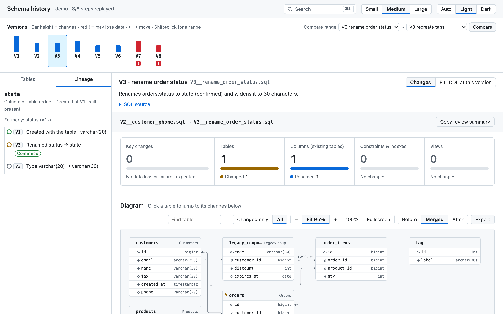<br>**Lineage.** `orders.state` was created as `status` in V1 and renamed in V3; the rename is confirmed. | 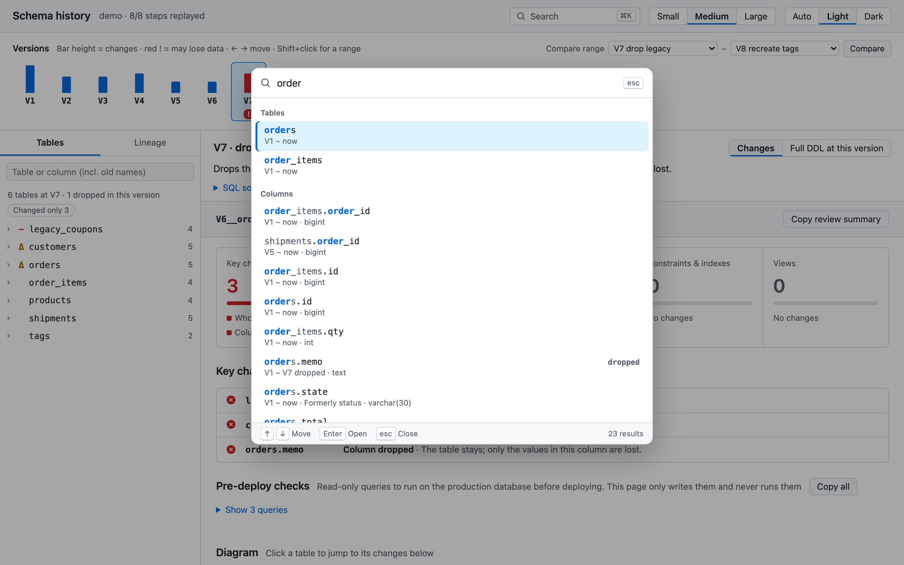<br>**Global search.** One box for tables, columns (with old names), versions, SQL source and commands. |
| 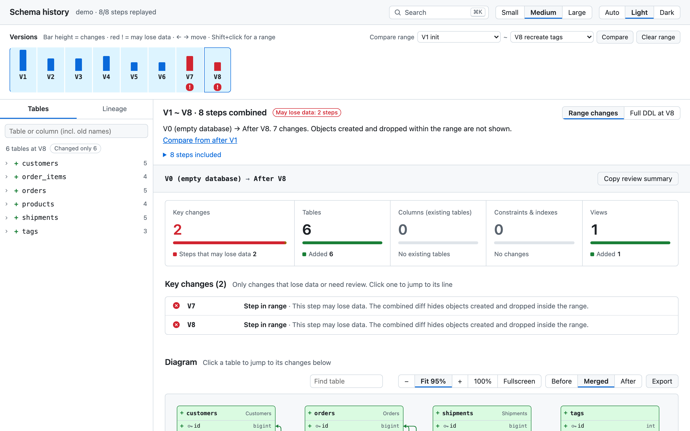<br>**Range compare.** Shift-click or pick two versions to see their combined change. | 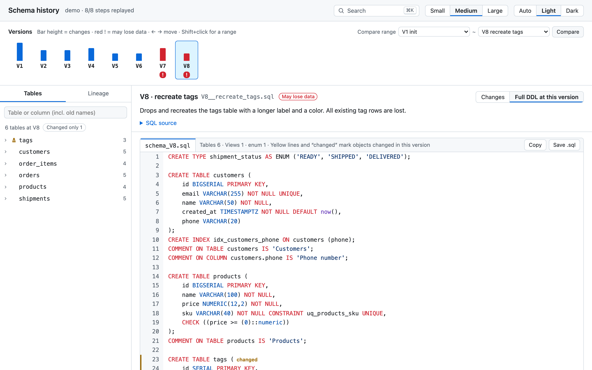<br>**Schema at a version.** The full DDL at V8, with the objects changed in that version marked. |
| 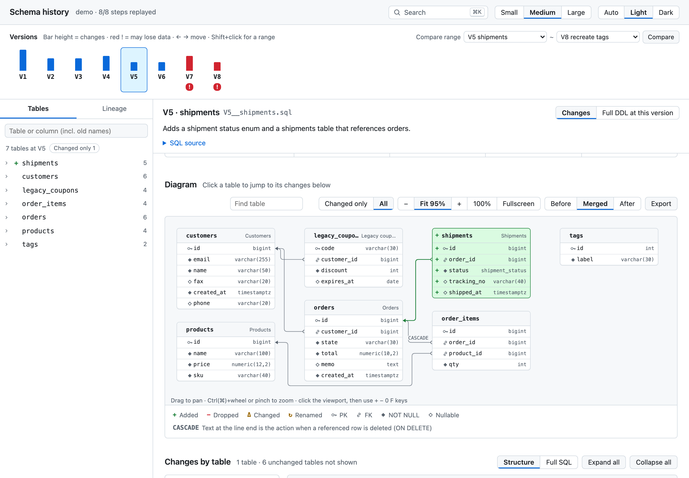<br>**Diagram.** V5 adds `shipments` (green) with an FK to `orders`. Before, Merged and After views; zoom, pan, find and export. | 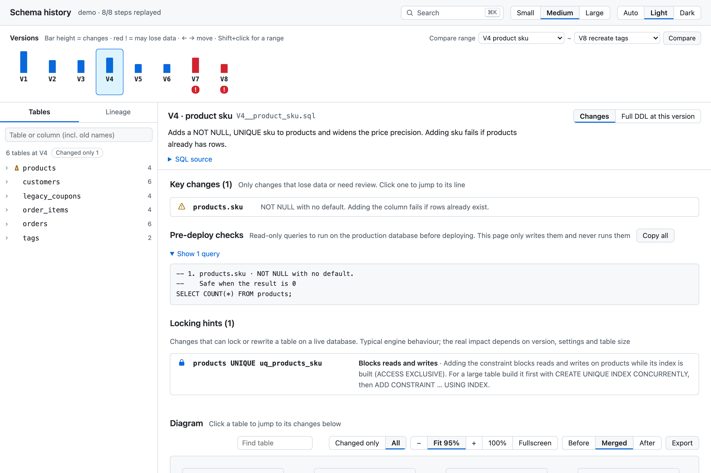<br>**Pre-deploy checks and locking hints.** V4 adds a `NOT NULL` column with no default: the page writes the `SELECT` to run first and notes that the `UNIQUE` constraint locks the table. |
| 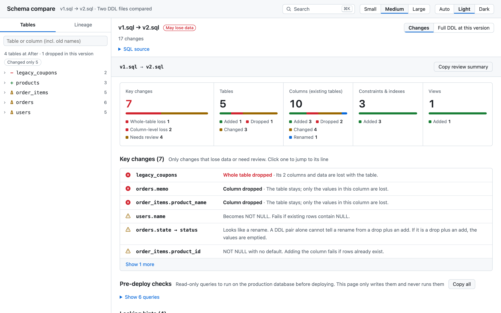<br>**Two-DDL compare.** `compare.sh v1.sql v2.sql` gives the same review for two schema dumps. A rename can only be *suspected* here. | 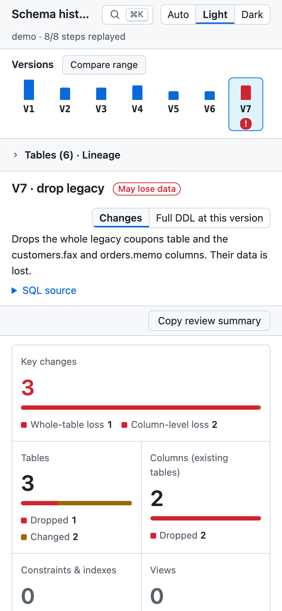<br>**On a phone.** The table list and range compare fold away so the review starts on the first screen. |

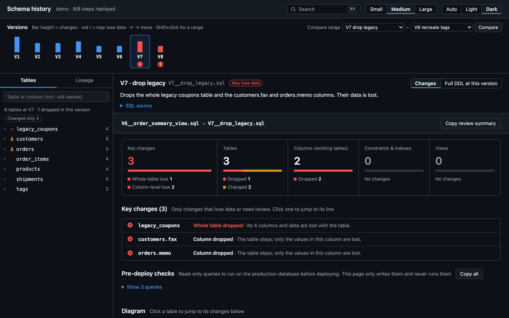

## Requirements

- Docker
- Python 3.9 or later (standard library only)
- Optional: Node.js 22 or later with Google Chrome or Chromium, to self-check the generated page in a headless browser (`check_html.mjs`) and to capture screenshots (`docs/capture.mjs`).
- Optional: Node.js alone, to export ERDs (`export_erd.mjs`) and to print the CI review report (`report.mjs`).
- Windows: use WSL 2. The entry scripts are bash.

Default images are pulled only when needed:

| `--db` | Image |
|---|---|
| `postgres` (default) | `postgres:16-alpine` |
| `mysql` | `mysql:8.4` |
| `mariadb` | `mariadb:11.4` |
| `oracle` | `gvenzl/oracle-free:23-slim` (takes tens of seconds to start) |

## Installation

As a plugin (Claude Code 2.1.275 or later), inside Claude Code:

```
/plugin install schema-timeline --marketplace <owner>/<repo>
```

Or clone the repository into your skills directory:

```bash
git clone <your-repo-url> ~/.claude/skills/schema-timeline
```

Both give the same skill. To use it in a single project only, clone it into `<project>/.claude/skills/schema-timeline` instead.

## Usage

### With Claude Code

Ask in plain language from a repository that has migrations. For example:

- "Show me the migration history of this repo."
- "When was `orders.state` added, and what was it called before?"
- "What changed between V5 and V20?"
- "Compare `schema_before.sql` and `schema_after.sql`."

Claude does the following:
1. Detects the migration format and the database.
2. Asks only what it cannot detect, such as which schema or whether to pull an image.
3. Replays the history and writes a one-line summary for each step, in the language you are writing in. The page UI follows the same language.
4. Opens the generated `timeline.html`.

### From the command line

```bash
# Migration history → <out>/timeline.html
bash scripts/timeline.sh <repo-or-migration-dir> <out> [--db postgres|mysql|mariadb|oracle] \
     [--format flyway|sqlfiles|supabase|prisma|drizzle|git-snapshots] [--file <path>] \
     [--schema <name>] [--image <image>] [--ignore-repeatable] [--lang en|ko] \
     [--no-sql] [--step-timeout <seconds>]

# Two DDL files → <out>/timeline.html (one-step timeline titled "Schema compare" in English, "스키마 비교" in Korean; <out> defaults to ./out)
bash scripts/compare.sh before.sql after.sql [<out>] [--db ...] [--image ...] [--schema ...] [--lang en|ko]

# Review report for CI or a PR comment (risks per step; exit 4 when risks at --fail-on exist)
node scripts/report.mjs <out> [--step N | --from A --to B | --all] [--format json|md] \
     [--fail-on danger|attention|none] [--lang en|ko]

# Mermaid ERD of the schema after step N
node scripts/export_erd.mjs <out> --step N --out erd.mmd

# Remove containers and networks left by an interrupted run
python3 scripts/replay.py --cleanup
```

- `--no-sql` leaves the SQL source text out of the page (the regenerated DDL stays). Use it when migrations contain seed data you do not want to share. The output directory itself still holds the SQL.
- `--step-timeout` stops a step that runs longer than the given seconds (default 300, `0` for no limit) and marks it failed.
- Containers run with resource limits: 1 GB memory (3 GB for Oracle), 2 CPUs and a process cap. Override them with `SCHEMA_TIMELINE_MEMORY`, `SCHEMA_TIMELINE_CPUS` and `SCHEMA_TIMELINE_PIDS`.

`--lang` picks the page and terminal language. Without it, `SCHEMA_TIMELINE_LANG` is used, then the system locale (Korean locales get `ko`), then English. Step summaries are optional: put `{"<file name>": "summary"}` into `<out>/summary.json` and re-run `render_timeline.py`.

`python3 scripts/detect.py <repo>` prints what was detected: the format, migration directories, database type, schema candidates and warnings.

### In CI

Run the replay on each pull request and post the report. A minimal GitHub Actions job:

```yaml
- uses: actions/checkout@v4
- run: git clone --depth 1 <your-repo-url> /tmp/schema-timeline
- run: docker pull postgres:16-alpine
- run: bash /tmp/schema-timeline/scripts/timeline.sh db/migration out --lang en --no-sql
- run: node /tmp/schema-timeline/scripts/report.mjs out --format md > review.md
```

`report.mjs` exit codes:

| Code | Meaning |
|---|---|
| 0 | No risks at or above `--fail-on` (default `danger`) |
| 4 | Risks at or above `--fail-on` exist |
| 1 | A replay step failed (takes precedence over 4) |
| 2 | Usage or file error |

The report uses the same rules as the page's "Key changes" list. Each risk carries its pre-deploy check query (`check`); each step also lists the combined `checks` script and its locking `hints`, which `--fail-on` never counts. It needs no Claude and no browser; step summaries written by Claude are not part of it.

### Try the demo

```bash
bash scripts/timeline.sh samples/demo /tmp/schema-demo
open /tmp/schema-demo/timeline.html        # xdg-open on Linux
```

You can link straight to a view: `#step=5`, `#step=5&view=ddl` or `#from=5&to=20` (range).

## Supported inputs

| History layout | `--format` |
|---|---|
| Flyway `V<version>__<desc>.sql` | `flyway` (default) |
| Numbered or timestamped SQL files, including Liquibase *formatted SQL* applied file by file | `sqlfiles` |
| Supabase CLI `supabase/migrations/<ts>_<name>.sql` | `supabase` |
| Prisma Migrate `prisma/migrations/<ts>_<name>/migration.sql` | `prisma` |
| Drizzle Kit `NNNN_<name>.sql` + `meta/_journal.json` | `drizzle` |
| One schema file (`schema.sql`, `init.sql`) edited over time in git | `git-snapshots --file <path>` |

Engines: PostgreSQL, MySQL, MariaDB and Oracle. Prisma and Drizzle are replayed when their provider or dialect is one of these; pass the matching `--db` (for example `--db mysql`), since the default is `postgres`. Supabase is replayed on PostgreSQL with a minimal stand-in for the platform schemas (`auth`, `storage`, roles).

## How it works

```
sources.py   →  replay.py           →  timeline.py               →  render_timeline.py
(adapters:      (apply each step in     (step diffs, events,         (single HTML page;
 Flyway, …)      a temp container,       lineage, rename              templates/)
                 snapshot catalog)       confirmation)
```

Engine-specific start-up, apply and catalog queries live in `engines.py` and `engine_*.py`. Afterwards `timeline.sh` and `compare.sh` run `check_html.mjs`, which opens the page in headless Chrome, and save its JSON receipt to `<out>/check.json`. It checks for script errors, external requests, layout overflow at 1280 px and 375 px, every step's review, ERD export and search.

## Safety

- **Never connects to your database.** Replays run in a temporary container with networking disabled, which is removed afterwards. Oracle needs a private IP, so it gets a Docker `--internal` network with no outside route, created and removed per run.
- **Connection settings are only sniffed.** `detect.py` looks at the JDBC URL in files such as `flyway.conf` or `application.yml` only to tell the database type and schema name. URLs, user names and passwords are never connected to, recorded or passed on.
- **Your repository is read-only.** When Claude runs the skill, output goes to `~/.cache/schema-timeline/<repo>/` unless you choose another place.
- **Secrets are masked.** Passwords in SQL (for example `IDENTIFIED BY`, `PASSWORD`) and in catalog text are masked before they reach the page. Other data in the SQL (seed rows, comments) is not; use `--no-sql` to leave the SQL out.
- **Bounded runs.** Each container has memory, CPU and process limits, every step has a timeout, and every container and network carries a `schema-timeline` label so `replay.py --cleanup` can remove leftovers.
- **Untrusted migrations.** A migration can run any SQL inside its container. Run histories from untrusted sources (for example pull requests from forks) on an isolated CI runner. See [SECURITY.md](SECURITY.md).

## Limitations

- SQL Server is not supported yet.
- Not replayed:
  - Liquibase XML/YAML changelogs
  - Code-based migrations (Java, Alembic, Rails, Django)
  - Flyway repeatable migrations, callbacks and placeholders
- Snapshots cover one schema's tables, columns, constraints, indexes, views and comments, plus PostgreSQL enum types. Functions, procedures, triggers, packages and sequences are not part of the schema diff; each step lists them by name as added, dropped, changed or (on Oracle) invalid. Domains and RLS policies are not captured.
- Ignored files are reported, not replayed: Flyway undo (`U…`) and baseline (`B…`) migrations, lowercase `v…` files and `.SQL` extensions. Version gaps are noted.
- Renames are confirmed only when the history is replayed on one database. Two-DDL compare and `git-snapshots` can only mark a rename as *suspected*.
- MySQL, MariaDB and Oracle DDL is not transactional. A failed step is left partially applied, and no snapshot is taken for it.
- The DDL shown at each version is regenerated from the catalog. It is not byte-identical to your source files.
- Scale: a synthetic PostgreSQL history of 300 steps ending with 152 tables took about 2 minutes to replay, render and self-check on an Apple M3 Pro, and produced a 6.5 MB page. Every run replays from an empty database; there is no incremental cache.

## Development

See [CONTRIBUTING.md](CONTRIBUTING.md) for setup, conventions and the pull request checklist, and [CHANGELOG.md](CHANGELOG.md) for release notes.

```bash
python3 -m unittest discover -s tests          # 237 tests; replay tests need Docker and the engine image (CI skips MySQL, MariaDB and Oracle)
node scripts/check_html.mjs <out>/timeline.html # headless self-check, prints a JSON receipt
bash docs/build_demo.sh                         # replay samples/demo in both languages and regenerate the README screenshots and GIF (GIF needs Pillow)
```

```
SKILL.md         instructions Claude follows when the skill triggers
.claude-plugin/  plugin and marketplace manifests
scripts/         detection, replay, diff, lineage, rendering, checks
templates/       timeline page, change review page, shared CSS/JS
references/      engine- and tool-specific notes Claude reads before replaying
samples/         example histories (demo, flyway, mysql, oracle, oracle_retail, supabase, prisma, drizzle)
tests/           unit and replay tests
docs/            README screenshots and GIF (en/, ko/), demo step summaries and the scripts that rebuild them
```

## Trademarks and third-party images

Flyway, Oracle, PostgreSQL, MySQL, MariaDB, Supabase, Prisma and Drizzle are trademarks of their respective owners. This project is not affiliated with or endorsed by them.

Database images are pulled from Docker Hub at run time and are not part of this repository. Each comes under its own license; `gvenzl/oracle-free` contains Oracle Database Free, which is subject to Oracle's Free Use Terms and Conditions.

## License

[MIT](LICENSE)
